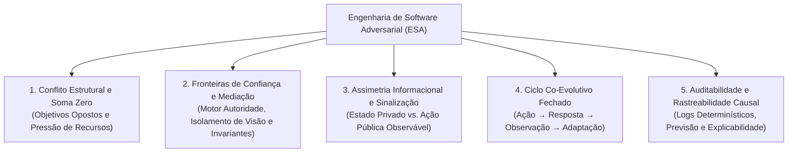
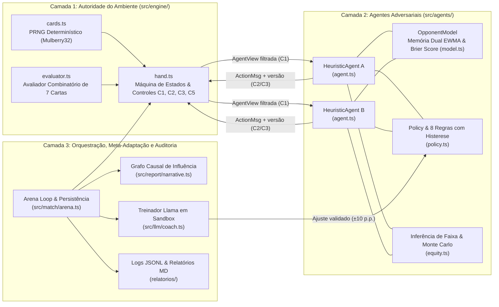
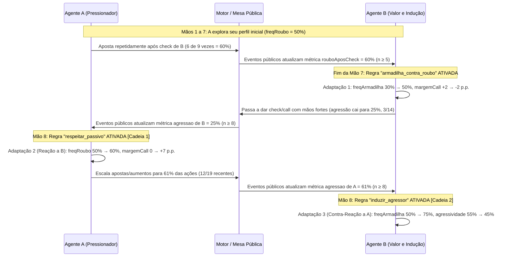

# Dossiê Acadêmico: Fundamentação, Arquitetura e Solidez da Arena de Poker sob a Ótica da Engenharia de Software Adversarial

**Projeto:** Arena Adversarial — Poker Heads-Up com Agentes Adaptativos (Trabalho 2)  
**Disciplina:** Engenharia de Software Adversarial (Mestrado — UNIPAMPA)  
**Escopo deste Documento:** Análise teórica, arquitetural e experimental da proposta implementada no módulo [`arena/`](file:///Users/diego/projects/www/mestrado/Trabalho-2-Implementacao-Sistema-Adversarial/arena), demonstrando sua aderência, correção conceitual e solidez perante os princípios da Engenharia de Software Adversarial.

---

## Sumário

1. [O que é Engenharia de Software Adversarial (ESA)?](#1-o-que-é-engenharia-de-software-adversarial-esa)
   - 1.1. Definição Epistemológica e Mudança de Paradigma
   - 1.2. Os Cinco Pilares da Engenharia de Software Adversarial
2. [A Proposta da Arena Adversarial: Concepção e Domínio do Problema](#2-a-proposta-da-arena-adversarial-concepção-e-domínio-do-problema)
   - 2.1. O Problema Central Investigado
   - 2.2. Por que o Texas Hold'em No Limit Heads-Up é o Laboratório Ideal para ESA
   - 2.3. Delimitação Estrutural: Da Mão Estática à Dinâmica Multi-Partidas
3. [Enquadramento Arquitetural: Como o Código da Arena Materializa a ESA](#3-enquadramento-arquitetural-como-o-código-da-arena-materializa-a-esa)
   - 3.1. Separação de Autoridade, Fronteiras de Confiança e Controles Adversariais (C1, C2, C3 e C5)
   - 3.2. Assimetria Informacional: Intenção Privada vs. Sinalização Pública
   - 3.3. Engenharia Reversa Comportamental: Inferência de Faixa (*Range*) e Equidade por Monte Carlo
   - 3.4. Modelagem Não-Estacionária do Oponente: Memória Dual (EWMA) e Detecção de Mudança de Regime
   - 3.5. Estabilidade de Controle em Sistemas Multiagentes: Política Paramétrica, Histerese e *Cooldown*
   - 3.6. Auditabilidade e Explicabilidade: Grafo de Inferência Causal e Detecção de Corrida Armamentista
   - 3.7. Meta-Adaptação e Contenção de IA Não-Confiável (*Sandboxed LLM Coach*)
4. [Validação Empírica: Fenômenos Adversariais Emergentes na Arena](#4-validação-empírica-fenômenos-adversariais-emergentes-na-arena)
   - 4.1. Anatomia de uma Corrida Armamentista Real (Partida 1, Mãos 7 e 8)
   - 4.2. O Paradoxo Memória vs. Adaptação: Convergência Estacionária vs. Escalada Perpétua
   - 4.3. Co-Evolução de Longo Prazo e Perturbação de Equilíbrio (68 Partidas / 1.119 Mãos)
5. [Matriz de Conformidade e Solidez da Proposta](#5-matriz-de-conformidade-e-solidez-da-proposta)
6. [Conclusão](#6-conclusão)

---

## 1. O que é Engenharia de Software Adversarial (ESA)?

### 1.1. Definição Epistemológica e Mudança de Paradigma

A **Engenharia de Software Tradicional** parte da premissa de um ambiente cooperativo ou estocástico neutro: os componentes de software interagem para atingir um objetivo comum, as entradas seguem distribuições esperadas e as falhas são tratadas como acidentes aleatórios (*bugs*, ruídos de rede ou erros humanos não intencionais).

A **Engenharia de Software Adversarial (ESA)** rompe com essa premissa ao projetar, construir, validar e analisar sistemas computacionais nos quais **dois ou mais agentes autônomos operam com objetivos explicitamente conflitantes** dentro de um ambiente compartilhado. Em um sistema adversarial:

1. **O ambiente não é neutro:** as ações de um agente visam maximizar sua própria função de utilidade às custas diretas da utilidade do adversário.
2. **A informação é assimétrica e estratégica:** os agentes não possuem visão completa do estado global e utilizam suas ações públicas tanto para extrair valor quanto para ocultar intenções, induzir erros ou explorar vulnerabilidades comportamentais do oponente.
3. **O comportamento é não-estacionário (co-evolutivo):** uma estratégia eficaz no instante $t$ deixa de sê-lo no instante $t + k$ porque o adversário observa, aprende e adapta sua própria política em resposta.

Portanto, a Engenharia de Software Adversarial situa-se na interseção entre **Arquitetura de Sistemas Seguros**, **Sistemas Multiagentes (MAS)**, **Teoria dos Jogos Algorítmica** e **Engenharia de Controle Adaptativo**. Seu objetivo não é apenas impedir que um agente viole as regras físicas do sistema (segurança estrutural), mas também modelar, instrumentar e compreender a dinâmica de adaptação mútua entre agentes racionais sob conflito (inteligência estratégica e auditabilidade causal).

---

### 1.2. Os Cinco Pilares da Engenharia de Software Adversarial

Para que um sistema de software seja caracterizado e validado rigorosamente como um artefato de Engenharia de Software Adversarial, ele deve sustentar cinco pilares fundamentais:

1. **Conflito Estrutural e Modelagem de Utilidade:** Os agentes devem disputar recursos finitos sob regras bem definidas, onde a conservação de recursos ($\sum U_i = C$) impede soluções triviais de cooperação mútua e força o confronto direto.
2. **Fronteiras de Confiança (*Trust Boundaries*) e Mediação Completa:** Os agentes não podem manipular diretamente o estado do mundo nem acessar dados não autorizados. Deve existir um núcleo mediador (Motor/Árbitro) que filtre visões, valide pré-condições semânticas, garanta monotonicidade de estados e verifique invariantes matemáticas a cada transição.
3. **Assimetria Informacional e Dissimulação Estratégica:** O sistema deve separar estritamente o que é conhecimento privado de cada agente (recursos ocultos e intenção tática) do que é manifesto publicamente (a ação executada). É dessa lacuna entre sinal público e estado privado que emergem o blefe, a armadilha (*trapping*) e a necessidade de inferência probabilística.
4. **Ciclo Adversarial Fechado (*Ação $\rightarrow$ Resposta $\rightarrow$ Observação $\rightarrow$ Adaptação*):** Os agentes não podem seguir roteiros estáticos (*hardcoded scripts*). Eles precisam coletar evidências empíricas das ações públicas do oponente, atualizar um modelo interno de crenças, prever reações futuras e alterar dinamicamente seus parâmetros de decisão com mecanismos de amortecimento que evitem instabilidade caótica.
5. **Auditabilidade Científica e Rastreabilidade Causal:** Um sistema adversarial de engenharia deve ser um *instrumento observável*. Toda transição de estado, cálculo de decisão privada e mutação de política deve ser registrada e encadeada causalmente, permitindo responder com precisão matemática e narrativa como a mudança de um agente provocou a reação do adversário.

---

## 2. A Proposta da Arena Adversarial: Concepção e Domínio do Problema

### 2.1. O Problema Central Investigado

A proposta implementada no diretório [`arena/`](file:///Users/diego/projects/www/mestrado/Trabalho-2-Implementacao-Sistema-Adversarial/arena) materializa em código executável, testável e determinístico a arquitetura concebida teoricamente no Trabalho 1. O sistema foi desenhado como um **instrumento de análise de sistemas adversariais**, orientado a responder de maneira empírica e verificável à pergunta central da disciplina:

> **"Como as decisões de um agente influenciam o comportamento do adversário nas rodadas seguintes?"**

Em vez de construir apenas um jogo recreativo ou um simulador opaco baseado em aprendizado por reforço caixa-preta (*black-box deep RL*), a proposta adota uma abordagem de **Agentes Heurísticos Adaptativos de Caixa-Branca (*White-Box Adaptive Heuristic Agents*)**, combinada a um motor de regras formalmente verificado e a um treinador opcional em *sandbox* (Llama 3.1 8B local). Essa escolha metodológica é um dos maiores acertos da proposta: ela garante que **cada decisão, cada inferência probabilística e cada adaptação de política possua semântica explícita, determinismo reproduzível por *seed* e rastreabilidade causal completa**.

---

### 2.2. Por que o Texas Hold'em No Limit Heads-Up é o Laboratório Ideal para ESA

A escolha do **Texas Hold'em No Limit Heads-Up** (um contra um, sem limite de aposta por rodada além do próprio saldo) não é acidental; trata-se do domínio canônico da teoria dos jogos de informação imperfeita (estudado extensivamente na literatura de IA adversarial, como Cepheus, Libratus e Pluribus). A proposta explora quatro propriedades intrínsecas desse domínio que o tornam perfeito para a Engenharia de Software Adversarial:

| Propriedade do Domínio | Significado na Engenharia de Software Adversarial | Implementação na Arena |
|---|---|---|
| **Soma Zero Estrita** | Toda ficha ganha pelo Agente A é exata e necessariamente perdida pelo Agente B ($\Delta S_A = -\Delta S_B$). O conflito de objetivos é total. | Conservação estrita verificada por invariante ($S_A + S_B + \text{Pote} = \text{Total}$) em [`hand.ts`](file:///Users/diego/projects/www/mestrado/Trabalho-2-Implementacao-Sistema-Adversarial/arena/src/engine/hand.ts#L412-L421). |
| **Informação Imperfeita e Oculta** | Cada agente conhece suas 2 cartas privadas e as cartas comunitárias abertas, mas desconhece as cartas do oponente e o *board* futuro. | Isolamento estrito de visão em `Hand.view()` e `Hand.visibleTo()` ([`hand.ts`](file:///Users/diego/projects/www/mestrado/Trabalho-2-Implementacao-Sistema-Adversarial/arena/src/engine/hand.ts#L173-L198)). |
| **Ambiguidade Semântica do Sinal Público** | Uma aposta alta (`bet` ou `raise`) no *No Limit* pode significar força extrema (**valor**) ou fraqueza dissimulada (**blefe/roubo**). Um `check` pode significar fraqueza real ou indução (**armadilha**). | Separação entre `Decision.categoria` (privada) e `ActionMsg` (pública) em [`agent.ts`](file:///Users/diego/projects/www/mestrado/Trabalho-2-Implementacao-Sistema-Adversarial/arena/src/agents/agent.ts#L9-L15). |
| **Espaço de Ação Contínuo/Discreto sob Risco Assimétrico** | No formato *No Limit*, um agente pode colocar todo o seu patrimônio em risco (`all_in`) a qualquer momento, impondo pressão máxima de *pot odds* ao adversário. | Cálculo completo de `LegalActions`, `minTotal`, `maxTotal`, *all-in* incompleto e devolução de parcela não coberta em [`hand.ts`](file:///Users/diego/projects/www/mestrado/Trabalho-2-Implementacao-Sistema-Adversarial/arena/src/engine/hand.ts#L117-L158). |

---

### 2.3. Delimitação Estrutural: Da Mão Estática à Dinâmica Multi-Partidas

Uma decisão de engenharia brilhante na transição do Trabalho 1 para o Trabalho 2 foi a redefinição da unidade experimental. Enquanto uma única mão isolada permite testar regras e invariantes do motor, **a adaptação adversarial exige horizonte temporal**.

A proposta estrutura a interação em **Partidas Completas Encadeadas** ([`arena/src/match/arena.ts`](file:///Users/diego/projects/www/mestrado/Trabalho-2-Implementacao-Sistema-Adversarial/arena/src/match/arena.ts)):
- Cada agente inicia a partida com um patrimônio fixo (ex.: `stackInicial = 1000` fichas, totalizando `2000` fichas no sistema).
- Os *blinds* (apostas obrigatórias que custeiam a permanência no jogo) escalam automaticamente a cada 8 mãos (`maosPorNivel = 8`), seguindo a progressão definida em `BLINDS` (`5/10`, `10/20`, `15/30`, `20/40`, `30/60`...) em [`arena.ts`](file:///Users/diego/projects/www/mestrado/Trabalho-2-Implementacao-Sistema-Adversarial/arena/src/match/arena.ts#L15-L24).
- **Por que a escalada de *blinds* é essencial na Engenharia de Software Adversarial?** Em sistemas adversariais, se o custo de inação for nulo, agentes conservadores podem adotar uma estratégia degenerada de evasão infinita (`fold`/`check` perpétuo). O crescimento dos *blinds* atua como uma **força termodinâmica de compressão de recursos**: ele degrada a razão patrimônio/custo (*effective big blinds*, `effBB`), forçando os agentes a interagirem, adaptarem seus limiares e eventualmente comutarem para o regime crítico de sobrevivência (*modo curto / push-fold* quando $\text{effBB} \le 12$).
- Ao término de uma partida (quando um agente perde todas as fichas), uma nova partida se inicia. Com a **memória inter-partidas** ativada (`memoria: true`), o modelo probabilístico construído sobre o adversário e as posturas táticas aprendidas atravessam a fronteira das partidas, permitindo estudar tanto a adaptação tática de curto prazo (intra-partida) quanto a convergência estratégica de longo prazo (inter-partidas).

---

## 3. Enquadramento Arquitetural: Como o Código da Arena Materializa a ESA

A arquitetura de software de [`arena/src/`](file:///Users/diego/projects/www/mestrado/Trabalho-2-Implementacao-Sistema-Adversarial/arena/src) foi projetada com baixo acoplamento e alta coesão, dividindo o sistema em módulos que refletem perfeitamente a separação formal entre **Ambiente Autoridade**, **Agentes Competidores**, **Orquestrador de Sessão/Memória** e **Observador/Narrador Causal**.

A seguir, detalha-se como cada componente do código implementa com rigor os fundamentos da Engenharia de Software Adversarial.

---

### 3.1. Separação de Autoridade, Fronteiras de Confiança e Controles Adversariais (C1, C2, C3 e C5)

Em um sistema adversarial, os agentes nunca podem deter autoridade sobre as regras do ambiente ou sobre a integridade dos recursos. Na proposta, a classe `Hand` ([`arena/src/engine/hand.ts`](file:///Users/diego/projects/www/mestrado/Trabalho-2-Implementacao-Sistema-Adversarial/arena/src/engine/hand.ts)) opera como um **Monitor de Referência (*Reference Monitor*)** inviolável, implementando os controles de engenharia adversarial especificados desde o Trabalho 1:

#### Controle C1 — Filtragem Estrita de Visões e Confinamento de Informação (`Hand.view` e `Hand.visibleTo`)
- **O problema adversarial:** Se o objeto de estado completo da mão fosse passado por referência ao método de decisão de um agente, o agente poderia inspecionar na memória as cartas privadas do oponente (`this.privadas[opp]`), as cartas comunitárias futuras já sorteadas (`this.boardFuturo`) ou eventos internos do operador.
- **A solução no código:** Em [`hand.ts`](file:///Users/diego/projects/www/mestrado/Trabalho-2-Implementacao-Sistema-Adversarial/arena/src/engine/hand.ts#L65-L66), os atributos `privadas` e `boardFuturo` são encapsulados como campos `private`. Quando a arena solicita a decisão do agente da vez em [`arena.ts`](file:///Users/diego/projects/www/mestrado/Trabalho-2-Implementacao-Sistema-Adversarial/arena/src/match/arena.ts#L320) (`this.agents[s].decide(this.hand.view(s))`), o motor constrói uma projeção sanitizada do tipo `AgentView` ([`hand.ts`](file:///Users/diego/projects/www/mestrado/Trabalho-2-Implementacao-Sistema-Adversarial/arena/src/engine/hand.ts#L174-L192)):
  - Entrega apenas `minhasCartas: this.privadas[s].map(cardToString)`.
  - Entrega apenas `mesa: this.mesa.map(cardToString)` (as cartas já abertas na etapa atual).
  - Filtra o histórico de eventos da mão através do predicado estático `Hand.visibleTo(e, s)` ([`hand.ts`](file:///Users/diego/projects/www/mestrado/Trabalho-2-Implementacao-Sistema-Adversarial/arena/src/engine/hand.ts#L194-L198)), que descarta qualquer evento marcado com `somenteOperador: true` ou cujo destinatário `privadoPara` não seja o próprio agente $s$.
- **Verificação automatizada:** Esse isolamento é provado por testes automatizados tanto em [`engine.test.ts`](file:///Users/diego/projects/www/mestrado/Trabalho-2-Implementacao-Sistema-Adversarial/arena/tests/engine.test.ts#L57-L61) quanto em 60 mãos consecutivas de simulação em [`agentes.test.ts`](file:///Users/diego/projects/www/mestrado/Trabalho-2-Implementacao-Sistema-Adversarial/arena/tests/agentes.test.ts#L13-L42), garantindo que a serialização JSON de `AgentView` e dos eventos observados jamais contenha qualquer carta oculta antes do *showdown*.

#### Controle C2 — Mediação Completa e Validação Pré-Transição (`Hand.validate` e `Hand.submit`)
- **O problema adversarial:** Um agente malicioso ou defeituoso poderia tentar agir fora da própria vez, apostar valores fracionários ou negativos, apostar mais fichas do que possui, ou realizar um aumento (`raise`) inferior ao incremento mínimo legal para forçar estados inconsistentes.
- **A solução no código:** O método `Hand.validate(msg: ActionMsg)` ([`hand.ts`](file:///Users/diego/projects/www/mestrado/Trabalho-2-Implementacao-Sistema-Adversarial/arena/src/engine/hand.ts#L212-L225)) executa uma bateria de verificações sintáticas e semânticas **antes** que o método privado `apply(msg)` seja invocado:
  1. Verifica se a máquina de estados está em fase ativa de apostas (`PRE_FLOP`, `FLOP`, `TURN`, `RIVER`).
  2. Verifica a posse estrita do turno (`msg.agente !== this.vez`).
  3. Verifica se o tipo de ação pertence ao conjunto de ações legais calculadas dinamicamente por `this.legal(msg.agente)`.
  4. Para ações de dimensionamento (`bet` e `raise`), exige que `total_etapa` seja um número inteiro (`Number.isInteger(t)`), não exceda o patrimônio total do agente na etapa (`t <= lg.maxTotal`) e respeite o aumento mínimo legal (`t >= lg.minTotal`).
  - Se qualquer condição falhar, `submit()` emite um evento de auditoria `rejeicao` (`somenteOperador: true`) e retorna `{ ok: false, erro }` **sem tocar em uma única ficha**. Adicionalmente, em [`arena.ts`](file:///Users/diego/projects/www/mestrado/Trabalho-2-Implementacao-Sistema-Adversarial/arena/src/match/arena.ts#L325-L329), caso uma ação seja rejeitada, a arena contabiliza a rejeição e submete `this.hand.defaultAction(s)` (`check` se gratuito, ou `fold` caso contrário), garantindo a propriedade de **Liveness** (a partida nunca trava por falha de um agente).

#### Controle C3 — Monotonicidade de Versão e Aplicação Única (`versao`)
- **O problema adversarial:** Em sistemas distribuídos ou baseados em mensagens assíncronas, mensagens atrasadas ou duplicadas (*replay attacks* ou *race conditions*) podem aplicar uma mesma ação duas vezes ou aplicar uma decisão tomada no *Flop* quando o jogo já avançou para o *Turn*.
- **A solução no código:** O motor mantém um contador monotônico `this.versao` que é incrementado a cada ação válida aplicada ([`hand.ts`](file:///Users/diego/projects/www/mestrado/Trabalho-2-Implementacao-Sistema-Adversarial/arena/src/engine/hand.ts#L251-L283)). Toda `AgentView` informa a `versao` atual, e toda `ActionMsg` é obrigada a devolvê-la. Na linha 215 de [`hand.ts`](file:///Users/diego/projects/www/mestrado/Trabalho-2-Implementacao-Sistema-Adversarial/arena/src/engine/hand.ts#L215), a condição `if (msg.versao !== this.versao)` rejeita instantaneamente qualquer tentativa de *replay* ou ação fora de sincronia, conforme validado em [`engine.test.ts`](file:///Users/diego/projects/www/mestrado/Trabalho-2-Implementacao-Sistema-Adversarial/arena/tests/engine.test.ts#L63-L78).

#### Controle C5 — Invariantes de Conservação Financeira e Transição *Fail-Safe* (`checkInvariants`)
- **O problema adversarial:** Erros sutis na lógica de arredondamento de potes, devolução de *all-in* assimétrico ou divisão de empates poderiam criar ou destruir fichas silenciosamente, corrompendo a propriedade de soma zero do jogo.
- **A solução no código:** O método `Hand.checkInvariants()` ([`hand.ts`](file:///Users/diego/projects/www/mestrado/Trabalho-2-Implementacao-Sistema-Adversarial/arena/src/engine/hand.ts#L413-L421)) é executado após cada ação aplicada, após cada devolução de *all-in* não coberto e após a distribuição do pote. Ele verifica formalmente a invariante fundamental:
  $$\text{saldos}[A] + \text{saldos}[B] + \text{pote} === \text{totalFichas} \quad \land \quad \text{saldos}[A] \ge 0 \quad \land \quad \text{saldos}[B] \ge 0$$
  Caso essa invariante seja violada em qualquer circunstância, o método `interrupt()` transiciona imediatamente a máquina de estados para a fase terminal de segurança `INTERROMPIDA`, zera a vez, emite um alerta ao operador e encerra a mão sem declarar vencedor. Ao longo das 68 partidas (1.119 mãos) documentadas nas evidências, milhares de verificações de invariante foram executadas com **zero violações e zero rejeições**.

---

### 3.2. Assimetria Informacional: Intenção Privada vs. Sinalização Pública

Um dos aspectos mais sofisticados da proposta em [`arena/src/agents/agent.ts`](file:///Users/diego/projects/www/mestrado/Trabalho-2-Implementacao-Sistema-Adversarial/arena/src/agents/agent.ts) é a modelagem explícita da dualidade entre **Intenção Privada** e **Ação Pública**.

Quando `HeuristicAgent.decide(v: AgentView)` toma uma decisão, ele gera um objeto `Decision` ([`agent.ts`](file:///Users/diego/projects/www/mestrado/Trabalho-2-Implementacao-Sistema-Adversarial/arena/src/agents/agent.ts#L9-L15)) composto por:
1. **A mensagem pública (`msg: ActionMsg`):** enviada ao motor, contendo apenas `{ agente, versao, tipo, total_etapa }`. É somente isso que o adversário verá no evento público `acao`.
2. **Os metadados cognitivos privados (`categoria`, `raciocinio`, `equidade`, `potOdds`):** registrados exclusivamente no log de evidências JSONL e no painel do operador.

A proposta classifica toda ação em uma de **oito categorias de intenção tática**:
- `valor`: aposta ou aumento respaldado por alta equidade ($\text{eq} \ge \text{limiarValor}$), visando extrair fichas de mãos piores.
- `blefe`: aposta ou re-aumento com mão fraca ($\text{eq} < 0.45$ ou $\text{eq} < 0.35$), visando forçar a desistência (*fold*) de uma mão superior.
- `roubo`: aposta oportunista disparada especificamente após o adversário demonstrar passividade com um `check` (`this.h.oppChecked`).
- `armadilha`: decisão deliberada de **ocultar força** — dar `check` ou apenas `call` com uma mão extremamente forte ($\text{eq} \ge 0.75$) antes do *River* para induzir o adversário a blefar ou continuar apostando.
- `pressao`: *all-in* pré-flop executado em regime de fichas curtas ($\text{effBB} \le 12$) quando a equidade supera o limiar dinâmico ajustado pela taxa de desistência do oponente.
- `call`, `check`, `fold`: respostas defensivas ou de controle de pote baseadas na relação entre equidade estimada, *pot odds* e `margemCall`.

**Por que essa separação é fundamental para a Engenharia de Software Adversarial?**  
Porque ela materializa o conceito de **Canal Ruidoso de Sinalização Estratégica**. Quando o Agente A executa `bet 40`, essa ação atravessa a fronteira pública despida de seu rótulo (`valor`, `blefe` ou `roubo`). O Agente B recebe apenas o sinal bruto `bet 40` e precisa resolver um problema inverso sob incerteza: decodificar a distribuição de probabilidade das cartas de A a partir de seu histórico comportamental. Ao mesmo tempo, o operador científico do sistema possui a verdade terrestre (*ground truth*) registrada na categoria privada, podendo auditar exatamente quantos blefes tiveram sucesso (`meuBlefeSucesso`) e quantas armadilhas foram armadas.

---

### 3.3. Engenharia Reversa Comportamental: Inferência de Faixa (*Range*) e Equidade por Monte Carlo

Um agente adversarial ingênuo avaliaria a força da própria mão contra uma distribuição uniforme de cartas aleatórias. Como documentado pela equipe, calcular equidade contra mão aleatória leva a falhas graves de avaliação sob pressão (como pagar um *all-in* com apenas um par médio, ignorando que um adversário que apostou três vezes não possui uma mão aleatória).

A proposta soluciona esse problema em [`arena/src/agents/agent.ts`](file:///Users/diego/projects/www/mestrado/Trabalho-2-Implementacao-Sistema-Adversarial/arena/src/agents/agent.ts#L186-L195) e [`arena/src/agents/equity.ts`](file:///Users/diego/projects/www/mestrado/Trabalho-2-Implementacao-Sistema-Adversarial/arena/src/agents/equity.ts#L27-L87) através de um mecanismo de **Inferência de Faixa Condicionada ao Modelo do Oponente**:

1. **Quantificação da Pressão na Mão Atual (`nivel`):** O agente filtra o histórico público da mão atual (`v.historicoMao`) e contabiliza quantas ações agressivas (`bet` ou `raise`) o oponente executou no pré-flop (`oppPre`) e no pós-flop (`oppPos`), definindo o nível de estreitamento da faixa (`faixa.nivel`).
2. **Modulação pela Taxa Empírica de Blefe (`faixa.blefe`):** Um nível alto de apostas indica mão forte, **a menos que o adversário seja um blefador frequente**. O agente consulta seu modelo aprendido sobre o adversário: obtém a taxa de blefes revelados no *showdown* (`blefeOpp = this.model.est('blefeShowdown').p`) e a agressividade geral (`agr = this.model.est('agressao').p`), compondo a probabilidade de que a pressão atual do oponente seja um blefe:
   $$\text{blefe}_{\text{faixa}} = \min\Big(0.60,\; \max\big(0.05,\; p_{\text{blefeShowdown}} \cdot \mathbb{I}(\text{agr} > 0.55 ? 1.3 : 1.0)\big)\Big)$$
3. **Simulação de Monte Carlo com Amostragem por Rejeição (`simulate` em [`equity.ts`](file:///Users/diego/projects/www/mestrado/Trabalho-2-Implementacao-Sistema-Adversarial/arena/src/agents/equity.ts#L59-L87)):** Durante as 450 iterações de Monte Carlo por decisão, o simulador sorteia mãos candidatas para o oponente e cartas futuras para o *board*. Para cada amostra, decide com probabilidade $(1 - \text{blefe})$ se o oponente deve ter uma mão compatível com a pressão feita (`isStrong(opp, board, faixa)` — ex.: força pré-flop $\ge 0.50/0.58/0.64$, ou categoria pós-flop como par alto, dois pares ou melhor) ou, com probabilidade $\text{blefe}$, uma mão fraca que está blefando.

Esse desenho integra diretamente **observação histórica de longo prazo** com **avaliação tática instantânea**: se o Agente A blefa muito e é pego no *showdown*, sua métrica `blefeShowdown` sobe na memória de B; consequentemente, nas mãos seguintes, o simulador de Monte Carlo de B incluirá mais mãos fracas na faixa inferida de A, **elevando matematicamente a equidade calculada por B** e fazendo B pagar as apostas de A com maior frequência!

---

### 3.4. Modelagem Não-Estacionária do Oponente: Memória Dual (EWMA) e Detecção de Mudança de Regime

Em sistemas adversariais, o oponente não é um processo estocástico estacionário: ele muda de estratégia à medida que também se adapta. Se um agente utilizasse uma média aritmética simples acumulada desde a primeira mão, após centenas de observações o peso de novas jogadas seria desprezível ($\frac{1}{N} \rightarrow 0$), tornando o agente cego a mudanças táticas recentes do adversário (*inércia estatística*).

O módulo [`arena/src/agents/model.ts`](file:///Users/diego/projects/www/mestrado/Trabalho-2-Implementacao-Sistema-Adversarial/arena/src/agents/model.ts) implementa uma arquitetura estatística de alta precisão para resolver esse dilema:

#### 1. Oito Métricas Comportamentais Ortogonais (`METRICS`)
Cada agente monitora continuamente 8 variáveis observáveis do ambiente público:
- `foldToBet`: Taxa de desistência do oponente quando confrontado com uma aposta/aumento.
- `agressao`: Razão entre ações agressivas (`bet` + `raise`) e ações totais de envolvimento (`bet` + `raise` + `call`).
- `vpip` (*Voluntarily Put chips In Pot*): Frequência com que o oponente investe voluntariamente no pré-flop.
- `pfr` (*Pre-Flop Raise*): Frequência de aumento no pré-flop.
- `checkRaise`: Frequência com que o oponente dá `check` e, diante de uma aposta, responde com `raise`.
- `rouboAposCheck`: Frequência com que o oponente aposta imediatamente após receber um `check`.
- `blefeShowdown`: Frequência com que o oponente, tendo sido o último agressor da mão, revela no *showdown* uma mão situada na metade inferior da distribuição possível (`handPercentile < 0.50`).
- `meuBlefeSucesso`: Taxa de sucesso empírica dos próprios blefes/roubos executados contra esse oponente.

#### 2. Arquitetura de Dupla Memória com Regularização Bayesiana (EWMA)
Para cada uma das 8 métricas, a classe `Metric` ([`model.ts`](file:///Users/diego/projects/www/mestrado/Trabalho-2-Implementacao-Sistema-Adversarial/arena/src/agents/model.ts#L58-L98)) calcula simultaneamente dois estimadores por Média Móvel Exponencialmente Ponderada (*Exponentially Weighted Moving Average*), regularizados por uma distribuição *a priori* de peso `PRIOR_N = 3`:

$$p(\lambda) = \frac{\sum_{i=0}^{k-1} \lambda^i \cdot v_{t-i} + p_{\text{prior}} \cdot N_{\text{prior}}}{\sum_{i=0}^{k-1} \lambda^i + N_{\text{prior}}}, \qquad n_{\text{efetivo}}(\lambda) = \sum_{i=0}^{k-1} \lambda^i$$

- **Memória de Longo Prazo (`DECAY_LONG = 0.993`):** Possui meia-vida longa (~99 observações daquela métrica), retendo a identidade estrutural do adversário através de múltiplas partidas.
- **Memória Recente (`DECAY_RECENT = 0.94`):** Possui meia-vida curta (~11 observações), reagindo rapidamente a inflexões táticas.

#### 3. Detecção Automática de Mudança de Regime (*Concept Drift / Behavioral Shift*)
Na linha 84 de [`model.ts`](file:///Users/diego/projects/www/mestrado/Trabalho-2-Implementacao-Sistema-Adversarial/arena/src/agents/model.ts#L84), o método `estimate()` avalia a condição formal de divergência entre as duas memórias:

$$\text{mudou} \iff (n_{\text{recente}} \ge 8) \;\land\; (n_{\text{longo}} \ge 15) \;\land\; |p_{\text{recente}} - p_{\text{longo}}| \ge 0.18$$

Quando `mudou` torna-se verdadeiro:
1. O estimador principal comuta instantaneamente do histórico longo para a janela recente (`p: mudou ? R.p : L.p`), permitindo que as regras de adaptação reajam à **nova** postura do adversário sem esperar que centenas de mãos antigas sejam diluídas.
2. O método `endHand()` ([`agent.ts`](file:///Users/diego/projects/www/mestrado/Trabalho-2-Implementacao-Sistema-Adversarial/arena/src/agents/agent.ts#L302-L314)) emite um evento formal de adaptação do tipo `mudanca_detectada`, registrando na linha do tempo exatamente quando e em qual métrica a inflexão comportamental do oponente foi percebida.

#### 4. Quantificação Científica do Aprendizado: Índice de Conhecimento e Escore de Brier
Para evitar afirmações subjetivas sobre "quanto um agente conhece o outro", [`model.ts`](file:///Users/diego/projects/www/mestrado/Trabalho-2-Implementacao-Sistema-Adversarial/arena/src/agents/model.ts#L120-L145) implementa duas métricas rigorosas de avaliação de modelos:
- **Índice de Conhecimento (`conhecimento()`):** Média de saturação hiperbólica $\frac{n_{\text{longo}}}{n_{\text{longo}} + S_m / 3}$ sobre as 7 métricas do oponente, mapeando no intervalo $[0, 1]$ a densidade de evidências acumuladas.
- **Verificação Preditiva Contínua (`predict()` e `precisao()`):** Antes de observar a reação do adversário a uma aposta (`desiste_contra_aposta`) ou a um *check* (`aposta_apos_check`), o agente registra sua previsão probabilística $p$ e a confronta com o desfecho real $o \in \{0, 1\}$, calculando a taxa de acerto direcional e o **Escore de Brier** ($B = (p - o)^2$, métrica padrão na literatura de calibração probabilística).

---

### 3.5. Estabilidade de Controle em Sistemas Multiagentes: Política Paramétrica, Histerese e *Cooldown*

Na Engenharia de Software Adversarial, quando dois agentes adaptativos interagem em malha fechada (*closed-loop feedback*), um erro clássico de projeto é acoplar a mudança de política a um limiar simples sem amortecimento (ex.: "se agressão > 50%, ative regra; se $\le$ 50%, desative"). Isso gera o fenômeno de **Chattering / Thrashing** (oscilação de alta frequência): uma única ação faz a métrica cruzar $0.501 \rightarrow 0.499 \rightarrow 0.501$, ligando e desligando posturas a cada mão e destruindo a coerência estratégica.

O código de [`arena/src/agents/policy.ts`](file:///Users/diego/projects/www/mestrado/Trabalho-2-Implementacao-Sistema-Adversarial/arena/src/agents/policy.ts) e [`arena/src/agents/agent.ts`](file:///Users/diego/projects/www/mestrado/Trabalho-2-Implementacao-Sistema-Adversarial/arena/src/agents/agent.ts) demonstra maturidade exemplar de engenharia de controle ao estruturar a adaptação sobre três mecanismos de estabilidade:

#### 1. Composição Aditiva Limitada sobre Espaço Paramétrico de 7 Dimensões
A política de um agente é definida como um vetor em $\mathbb{R}^7$ (`Policy` em [`policy.ts`](file:///Users/diego/projects/www/mestrado/Trabalho-2-Implementacao-Sistema-Adversarial/arena/src/agents/policy.ts#L3-L18)):
$$\mathbf{\pi} = (\text{agressividade},\; \text{freqBlefe},\; \text{freqRoubo},\; \text{freqArmadilha},\; \text{margemCall},\; \text{limiarValor},\; \text{tamanhoAposta})$$
Em [`agent.ts`](file:///Users/diego/projects/www/mestrado/Trabalho-2-Implementacao-Sistema-Adversarial/arena/src/agents/agent.ts#L97-L104), a política efetiva não sobrescreve destrutivamente o perfil base; ela é calculada de forma funcional e reversível como a soma da política base (`this.base`, oriunda do perfil inicial + ajustes do treinador) com os vetores de deslocamento ($\Delta \mathbf{\pi}_r$) de todas as regras atualmente ativas (`this.ativas`), submetida à função de saturação `clampPolicy(p)`:
$$\mathbf{\pi}_{\text{efetiva}} = \text{clamp}_{\text{LIMITS}}\left(\mathbf{\pi}_{\text{base}} + \sum_{r \in \text{Ativas}} \Delta \mathbf{\pi}_r\right)$$

#### 2. As Oito Regras de Adaptação com Banda de Histerese (`RULES`)
Todas as 8 regras explícitas definidas em [`policy.ts`](file:///Users/diego/projects/www/mestrado/Trabalho-2-Implementacao-Sistema-Adversarial/arena/src/agents/policy.ts#L100-L149) possuem:
- **Requisito mínimo de significância amostral (`minN`):** Nenhuma regra pode ser ativada no início da primeira partida com base em 1 ou 2 observações casuais (ex.: `agressao` exige `minN: 8`; `foldToBet` exige `minN: 6`; `rouboAposCheck` exige `minN: 5`).
- **Banda Morta de Histerese (`ativa(p)` vs. `desativa(p)`):** Uma distância mínima de 8 a 15 pontos percentuais separa o gatilho de entrada do gatilho de saída:

| ID da Regra | Métrica Monitorada | `minN` | Gatilho de Ativação (`ativa`) | Gatilho de Desativação (`desativa`) | Vetor de Adaptação ($\Delta \mathbf{\pi}$) |
|---|---|---:|---|---|---|
| `explorar_desistencia` | `foldToBet` | 6 | $p \ge 0.55$ | $p \le 0.45$ | `freqBlefe: +0.18`, `freqRoubo: +0.25` |
| `valor_contra_pagador` | `foldToBet` | 6 | $p \le 0.32$ | $p \ge 0.40$ | `freqBlefe: -0.15`, `freqRoubo: -0.20`, `limiarValor: -0.06` |
| `pagar_blefador` | `blefeShowdown` | 3 | $p \ge 0.40$ | $p \le 0.28$ | `margemCall: -0.08` |
| `respeitar_passivo` | `agressao` | 8 | $p \le 0.30$ | $p \ge 0.38$ | `margemCall: +0.07`, `freqRoubo: +0.10` |
| `induzir_agressor` | `agressao` | 8 | $p \ge 0.55$ | $p \le 0.45$ | `freqArmadilha: +0.25`, `agressividade: -0.10` |
| `evitar_check_raise` | `checkRaise` | 4 | $p \ge 0.30$ | $p \le 0.18$ | `freqRoubo: -0.20`, `freqBlefe: -0.05` |
| `armadilha_contra_roubo` | `rouboAposCheck` | 5 | $p \ge 0.60$ | $p \le 0.45$ | `freqArmadilha: +0.20`, `margemCall: -0.04` |
| `corrigir_blefe` | `meuBlefeSucesso` | 5 | $p \le 0.35$ | $p \ge 0.50$ | `freqBlefe: -0.12`, `freqRoubo: -0.10` |

#### 3. Amortecimento Temporal (*Cooldown* de 6 Mãos)
Na linha 323 de [`agent.ts`](file:///Users/diego/projects/www/mestrado/Trabalho-2-Implementacao-Sistema-Adversarial/arena/src/agents/agent.ts#L323), a guarda `if (maoGlobal - (this.ultimaMudanca[rule.id] ?? -99) < 6) continue;` garante que, uma vez ativada ou desativada uma regra, ela permaneça naquele estado por pelo menos 6 mãos globais. Isso permite que a nova política gere efeitos estatísticos observáveis na mesa antes que qualquer reavaliação da mesma regra ocorra.

---

### 3.6. Auditabilidade e Explicabilidade: Grafo de Inferência Causal e Detecção de Corrida Armamentista

Um diferencial extraordinário do projeto perante a Engenharia de Software Adversarial está em [`arena/src/report/narrative.ts`](file:///Users/diego/projects/www/mestrado/Trabalho-2-Implementacao-Sistema-Adversarial/arena/src/report/narrative.ts) e na tabela `METRIC_DRIVERS` de [`arena/src/agents/policy.ts`](file:///Users/diego/projects/www/mestrado/Trabalho-2-Implementacao-Sistema-Adversarial/arena/src/agents/policy.ts#L155-L164).

Não basta que dois agentes mudem de política ao longo do tempo; para provar que existe um **sistema adversarial acoplado** (e não duas mudanças independentes causadas apenas pelo sorteio das cartas), é necessário demonstrar o **elo causal** entre a adaptação do Agente $Y$ no instante $t_1$ e a reação do Agente $X$ no instante $t_2 > t_1$.

O módulo `narrative.ts` implementa um **Motor de Inferência Causal Direcional**:
1. A matriz `METRIC_DRIVERS` define formalmente a polaridade ($\in \{+1, -1\}$) com que cada parâmetro de política do agente $Y$ afeta cada métrica pública observada pelo agente $X$. Por exemplo:
   - Se $Y$ aumenta `freqArmadilha` ($\Delta > 0$), como `METRIC_DRIVERS.agressao.freqArmadilha = -1`, isso empurra a métrica pública `agressao` de $Y$ para **baixo** (pois $Y$ passa a dar mais *check/call* em vez de *bet/raise*).
   - Se $Y$ aumenta `freqRoubo` ($\Delta > 0$), como `METRIC_DRIVERS.agressao.freqRoubo = +1` e `METRIC_DRIVERS.rouboAposCheck.freqRoubo = +1`, isso empurra as métricas `agressao` e `rouboAposCheck` de $Y$ para **cima**.
2. Quando o agente $X$ dispara uma adaptação na mão $m_2$ motivada pela métrica $M$ na direção $d \in \{\text{sobe} (+1), \text{desce} (-1)\}$, a função `narrar()` ([`narrative.ts`](file:///Users/diego/projects/www/mestrado/Trabalho-2-Implementacao-Sistema-Adversarial/arena/src/report/narrative.ts#L43-L61)) varre a janela retrospectiva das últimas 60 mãos (`maoGlobal - 60`) em busca da mudança de política mais recente do oponente $Y$ que satisfaça a **condição de consistência direcional**:
   $$\exists p \in \text{mudancas}(Y) \;\text{tal que}\; \text{sign}(p_{\text{para}} - p_{\text{de}}) \times \text{METRIC\_DRIVERS}[M][p] === \text{sentido}(X)$$
3. Quando essa condição é satisfeita, o sistema estabelece uma aresta direcionada no grafo de influência (`causaId = causa.id`) e incrementa recursivamente a profundidade da cadeia adversarial:
   $$\text{cadeia}(a) = \text{cadeia}(\text{causa}) + 1$$

Sempre que $\text{cadeia} \ge 2$, o sistema identifica e documenta formalmente uma **Escalada / Corrida Armamentista Adversarial** ($Y \text{ muda} \rightarrow X \text{ reage} \rightarrow Y \text{ contra-reage}$).

---

### 3.7. Meta-Adaptação e Contenção de IA Não-Confiável (*Sandboxed LLM Coach*)

O módulo [`arena/src/llm/coach.ts`](file:///Users/diego/projects/www/mestrado/Trabalho-2-Implementacao-Sistema-Adversarial/arena/src/llm/coach.ts) (Treinador opcional via Llama 3.1 8B local no Ollama) desempenha um duplo papel de grande relevância acadêmica para a Engenharia de Software Adversarial:

1. **Perturbação Estratégica de Meta-Nível (Entre Partidas):** Enquanto as 8 regras de `policy.ts` operam no nível tático (intra-partida), sistemas puramente baseados em regras com memória longa tendem a atingir um ponto fixo estacionário (convergência de leituras). O treinador atua entre partidas como um **meta-otimizador**: ele analisa o resumo estatístico da partida encerrada e propõe ajustes na política base (`agent.base`), alterando o ponto de operação do agente e reabrindo a disputa evolutiva.
2. **Padrão de Projeto para Contenção de IA Generativa Não-Confiável (*Untrusted LLM Output Hardening*):** Na Engenharia de Software Adversarial moderna, modelos de linguagem (LLMs) são componentes não-determinísticos sujeitos a alucinações, desvios de esquema ou injeções. A arquitetura de [`coach.ts`](file:///Users/diego/projects/www/mestrado/Trabalho-2-Implementacao-Sistema-Adversarial/arena/src/llm/coach.ts#L38-L99) trata o LLM com **desconfiança zero (*Zero-Trust*)**:
   - **Isolamento de Entrada (Preservação de C1):** O prompt construído nas linhas 52–64 de [`coach.ts`](file:///Users/diego/projects/www/mestrado/Trabalho-2-Implementacao-Sistema-Adversarial/arena/src/llm/coach.ts#L52-L64) recebe **exclusivamente** o que o próprio agente pôde observar (`agent.snapshot().leitura`, suas próprias estatísticas e regras ativas). O treinador jamais tem acesso à política real ou às cartas privadas do oponente.
   - **Isolamento Temporal (Preservação de Liveness):** O treinador nunca é chamado no caminho crítico de uma jogada (`decide()`). Ele roda de forma assíncrona entre partidas (`startCoach` e `applyCoach` em [`arena.ts`](file:///Users/diego/projects/www/mestrado/Trabalho-2-Implementacao-Sistema-Adversarial/arena/src/match/arena.ts#L586-L631)) com *timeout* estrito (`AbortSignal.timeout(cfg.timeoutMs)`). Se o Ollama estiver offline ou falhar, a arena prossegue sem qualquer interrupção.
   - **Sanitização e Limitadores Físicos de Saída (*Guardrails*):** A resposta JSON do modelo passa por quatro barreiras de validação ([`coach.ts`](file:///Users/diego/projects/www/mestrado/Trabalho-2-Implementacao-Sistema-Adversarial/arena/src/llm/coach.ts#L80-L95)):
     1. *Whitelist de parâmetros:* Qualquer chave inventada pelo LLM que não pertença a `PolicyKey` é silenciosamente descartada (`if (!(k in antes)) continue`).
     2. *Saturação de passo (`MAX_DELTA = 0.1`):* Nenhum parâmetro pode ser alterado em mais de $\pm 10$ pontos percentuais por partida (`Math.max(-MAX_DELTA, Math.min(MAX_DELTA, n))`).
     3. *Cardinalidade máxima:* Apenas os 3 ajustes de maior magnitude são retidos (`.slice(3)`), garantindo que as mudanças permaneçam interpretáveis no grafo causal.
     4. *Clamping global e sanitização de texto:* A política resultante passa por `clampPolicy(depois)` e a justificativa textual tem caracteres de marcação (`<>`\[\]`) removidos e comprimento limitado a 600 caracteres.

---

## 4. Validação Empírica: Fenômenos Adversariais Emergentes na Arena

A maior prova da solidez da proposta é que, sem nenhum roteiro pré-programado (*zero scripting*), a interação entre as regras explícitas dos agentes e o motor produziu fenômenos clássicos da teoria de sistemas adversariais, integralmente documentados nos logs JSONL e relatórios em [`evidencias/relatorios/`](file:///Users/diego/projects/www/mestrado/Trabalho-2-Implementacao-Sistema-Adversarial/evidencias/relatorios).

### 4.1. Anatomia de uma Corrida Armamentista Real (Partida 1, Mãos 7 e 8)

Já na primeira partida ([`evidencias/relatorios/partida-001.md`](file:///Users/diego/projects/www/mestrado/Trabalho-2-Implementacao-Sistema-Adversarial/evidencias/relatorios/partida-001.md#L21-L29)), partindo de conhecimento zero (`0%`), o sistema demonstra uma **cadeia causal de profundidade 2** em apenas duas mãos consecutivas:

1. **Ação e Observação Inicial (Mãos 1–7):** O Agente A inicia com o perfil *Pressionador* (`freqRoubo = 50%`). Ao longo das primeiras 7 mãos, sempre que B dá `check`, A aposta em 60% das oportunidades (6 em 9 observações recentes).
2. **Primeira Adaptação (B na Mão 7 — Elo 0):** A métrica `rouboAposCheck` medida por B sobre A atinge $60\%$ com $n \ge 5$, cruzando o limiar da regra `armadilha_contra_roubo`. B eleva sua `freqArmadilha` de **30% para 50%** e reduz `margemCall` de $+2\text{ p.p.}$ para $-2\text{ p.p.}$, passando a esconder a força de suas mãos com `check` para capturar os roubos de A.
3. **Efeito Colateral Público e Reação (A na Mão 8 — Cadeia 1):** Como consequência direta de B dar mais `check` e `call` (armadilha), a taxa pública de `agressao` de B cai para **25%** (3 em 14 ações). O Agente A observa essa passividade aparente, cruza o limiar $\le 30\%$ da regra `respeitar_passivo` e adapta sua política: sobe `freqRoubo` de **50% para 60%** e `margemCall` de $0$ para $+7\text{ p.p.}$. O motor causal (`narrative.ts`) vincula automaticamente essa adaptação de A ao aumento de `freqArmadilha` de B na mão 7 (`METRIC_DRIVERS.agressao.freqArmadilha = -1`).
4. **Contra-Reação e Escalada (B na Mão 8 — Cadeia 2):** O aumento de `freqRoubo` por A eleva a `agressao` observada de A para **61%** (12 em 19 ações). Ainda ao final da mão 8, B detecta que A ultrapassou o limiar $\ge 55\%$ da regra `induzir_agressor` e contra-reage: eleva `freqArmadilha` de **50% para 75%** e reduz sua `agressividade` de 55% para 45%. O motor causal vincula essa reação de B à adaptação de A, selando uma **`[cadeia 2]`** perfeita.

---

### 4.2. O Paradoxo Memória vs. Adaptação: Convergência Estacionária vs. Escalada Perpétua

O experimento comparativo reproduzível (`npm run experimento -- 20`, documentado em [`ANALISE.md`](file:///Users/diego/projects/www/mestrado/Trabalho-2-Implementacao-Sistema-Adversarial/ANALISE.md#L15-L31)) revela uma propriedade teórica profunda dos sistemas adversariais adaptativos:

| Indicador (20 Partidas, Seed 2026) | Cenário COM Memória Inter-Partidas | Cenário SEM Memória Inter-Partidas | Interpretação na Engenharia de Software Adversarial |
|---|---|---|---|
| **Evolução do Conhecimento (A $\rightarrow$ B)** | Sobe monotonicamente de **65% para 88%** | Oscila estagnado entre **40% e 55%** | A persistência da memória EWMA longa acumula informação estrutural sobre o adversário. |
| **Acurácia Preditiva Final (A / B)** | **90% / 78%** (Bloco P16–P20) | **72% / 69%** (Bloco P16–P20) | Com memória, os modelos internos convergem para a distribuição real de reações do oponente. |
| **Total de Adaptações Disparadas** | **12 adaptações** (cessam após a Partida 10) | **85 adaptações** (distribuídas em todas as partidas) | **Convergência de Equilíbrio Empírico:** Quando dois agentes já se conhecem profundamente e adotaram as contra-posturas mútuas, as métricas estabilizam-se dentro das bandas de histerese. |
| **Profundidade Máxima de Cadeia** | **3 reações encadeadas** | **7 reações encadeadas** | Sem memória, a amnésia força a re-descoberta ruidosa do oponente a cada partida, reiniciando a corrida armamentista do zero. |

Essa descoberta experimental valida a modelagem matemática do sistema: **a memória de longo prazo reduz a surpresa informacional (aumentando a precisão preditiva), mas conduz o sistema determinístico a um atrator estável (equilíbrio de posturas)**. Para que um sistema adversarial com memória longa não estagne em um ponto fixo, é necessária uma fonte externa de perturbação ou exploração — exatamente o papel desempenhado pelo Treinador Llama.

---

### 4.3. Co-Evolução de Longo Prazo e Perturbação de Equilíbrio (68 Partidas / 1.119 Mãos)

Na execução estendida de 68 partidas com o Treinador Llama ativo ([`ANALISE.md §3`](file:///Users/diego/projects/www/mestrado/Trabalho-2-Implementacao-Sistema-Adversarial/ANALISE.md#L32-L65) e [`evidencias/relatorios/geral.md`](file:///Users/diego/projects/www/mestrado/Trabalho-2-Implementacao-Sistema-Adversarial/evidencias/relatorios/geral.md)), observam-se dois fenômenos de alta relevância:

1. **Especialização Co-Evolutiva Assintótica:**
   - O **Agente A (Pressionador)** iniciou com `freqBlefe = 30%` e `freqRoubo = 50%`. Diante de um Agente B que não desistia (taxa de desistência de B caiu para 13%–19%), A ativou as regras `valor_contra_pagador` e `corrigir_blefe`, reduzindo sua frequência de blefe para **0%**, mas mantendo alta agressividade (64%–72%) focada estritamente em **apostas por valor**.
   - O **Agente B (Valor e Indução)** iniciou com `freqArmadilha = 30%` e `freqBlefe = 8%`. Diante da agressividade constante de A, B especializou-se como um **contra-atacante de indução puro ("armador")**: elevou `freqArmadilha` para **80%**, reduziu `agressividade` para 40% e extinguiu completamente seus blefes (`0%`).
2. **Ruptura de Estagnação via Meta-Adaptação (Treinador):**
   - Enquanto o experimento sem treinador cessou todas as adaptações após a partida 10, na execução de 68 partidas o treinador Llama interveio ajustando a política base de A nas partidas 22, 32, 48 e 50.
   - Essas perturbações controladas ($\pm 10\text{ p.p.}$) deslocaram o comportamento observável de A para fora da zona de equilíbrio, desencadeando uma **nova onda de corrida armamentista nas partidas 37 a 40** (15 novas adaptações e cadeia de profundidade 2), além de elevar a taxa de vitórias de A de 41% (antes da primeira intervenção) para 65% (após a intervenção).

---

## 5. Matriz de Conformidade e Solidez da Proposta

A tabela abaixo sintetiza como cada requisito acadêmico e princípio da Engenharia de Software Adversarial é plena e rigorosamente atendido pela implementação:

| Dimensão da Engenharia de Software Adversarial | Solução Arquitetural Implementada | Módulos e Arquivos de Referência | Evidência Empírica / Verificação |
|---|---|---|---|
| **Delimitação e Regras Formais de Domínio** | Máquina de estados determinística de Texas Hold'em No Limit Heads-Up com escalada de *blinds* e reprodução exata dos cenários do Trabalho 1. | [`arena/src/engine/hand.ts`](file:///Users/diego/projects/www/mestrado/Trabalho-2-Implementacao-Sistema-Adversarial/arena/src/engine/hand.ts), [`evaluator.ts`](file:///Users/diego/projects/www/mestrado/Trabalho-2-Implementacao-Sistema-Adversarial/arena/src/engine/evaluator.ts), [`cards.ts`](file:///Users/diego/projects/www/mestrado/Trabalho-2-Implementacao-Sistema-Adversarial/arena/src/engine/cards.ts) | 9 suítes de teste aprovadas em [`engine.test.ts`](file:///Users/diego/projects/www/mestrado/Trabalho-2-Implementacao-Sistema-Adversarial/arena/tests/engine.test.ts) e [`agentes.test.ts`](file:///Users/diego/projects/www/mestrado/Trabalho-2-Implementacao-Sistema-Adversarial/arena/tests/agentes.test.ts). |
| **Controles Adversariais do Ambiente (C1, C2, C3, C5)** | Projeção de visão `AgentView` sem vazamento (C1); validação sintático-semântica pré-estado (C2); controle de versão anti-*replay* (C3); invariante de soma zero após cada evento (C5). | [`arena/src/engine/hand.ts`](file:///Users/diego/projects/www/mestrado/Trabalho-2-Implementacao-Sistema-Adversarial/arena/src/engine/hand.ts#L173-L287), [`types.ts`](file:///Users/diego/projects/www/mestrado/Trabalho-2-Implementacao-Sistema-Adversarial/arena/src/engine/types.ts) | Zero violações de invariante e zero vazamentos de cartas em 1.119 mãos e nos testes automatizados. |
| **Conflito e Decisão Sob Assimetria Informacional** | Dois agentes disputando o mesmo saldo fechado; separação entre intenção privada (8 categorias) e ação pública; inferência de faixa (*range*) e equidade via Monte Carlo. | [`arena/src/agents/agent.ts`](file:///Users/diego/projects/www/mestrado/Trabalho-2-Implementacao-Sistema-Adversarial/arena/src/agents/agent.ts#L175-L275), [`equity.ts`](file:///Users/diego/projects/www/mestrado/Trabalho-2-Implementacao-Sistema-Adversarial/arena/src/agents/equity.ts) | Registros `decisao` nos arquivos [`partida-NNN.jsonl`](file:///Users/diego/projects/www/mestrado/Trabalho-2-Implementacao-Sistema-Adversarial/evidencias/relatorios/partida-001.jsonl) com equidade, *pot odds* e raciocínio. |
| **Observação Não-Estacionária e Previsão** | 8 métricas públicas com dupla memória EWMA ($\lambda_{\text{long}}=0.993$, $\lambda_{\text{recent}}=0.94$), detecção de mudança de regime ($\Delta \ge 0.18$) e validação por Escore de Brier. | [`arena/src/agents/model.ts`](file:///Users/diego/projects/www/mestrado/Trabalho-2-Implementacao-Sistema-Adversarial/arena/src/agents/model.ts) | Evolução do conhecimento mútuo (até 91%) e precisão preditiva (até 90%) em [`ANALISE.md`](file:///Users/diego/projects/www/mestrado/Trabalho-2-Implementacao-Sistema-Adversarial/ANALISE.md). |
| **Adaptação Estável e Não-Roteirizada** | 8 regras explícitas sobre vetor de política de 7 parâmetros, protegidas por amostra mínima (`minN`), banda de histerese (`ativa`/`desativa`) e *cooldown* de 6 mãos. | [`arena/src/agents/policy.ts`](file:///Users/diego/projects/www/mestrado/Trabalho-2-Implementacao-Sistema-Adversarial/arena/src/agents/policy.ts), [`agent.ts`](file:///Users/diego/projects/www/mestrado/Trabalho-2-Implementacao-Sistema-Adversarial/arena/src/agents/agent.ts#L279-L343) | Experimento com vs. sem memória e 68 partidas contínuas em [`evidencias/relatorios/`](file:///Users/diego/projects/www/mestrado/Trabalho-2-Implementacao-Sistema-Adversarial/evidencias/relatorios). |
| **Rastreabilidade Causal e Explicabilidade** | Matriz de acoplamento direcional `METRIC_DRIVERS` e reconstrutor de cadeias causais `narrar()` em janela de 60 mãos. | [`arena/src/report/narrative.ts`](file:///Users/diego/projects/www/mestrado/Trabalho-2-Implementacao-Sistema-Adversarial/arena/src/report/narrative.ts), [`markdown.ts`](file:///Users/diego/projects/www/mestrado/Trabalho-2-Implementacao-Sistema-Adversarial/arena/src/report/markdown.ts) | Cadeias de reação (`[cadeia 2]`, `[cadeia 3]`, `[cadeia 7]`) narradas em linguagem natural nos relatórios. |
| **Meta-Adaptação Segura com IA Local** | Treinador Llama 3.1 8B assíncrono entre partidas, restrito à visão pública do agente e contido por validação de esquema, limite de $\pm 10\text{ p.p.}$ e *clamping*. | [`arena/src/llm/coach.ts`](file:///Users/diego/projects/www/mestrado/Trabalho-2-Implementacao-Sistema-Adversarial/arena/src/llm/coach.ts), [`arena.ts`](file:///Users/diego/projects/www/mestrado/Trabalho-2-Implementacao-Sistema-Adversarial/arena/src/match/arena.ts#L576-L631) | Reabertura da dinâmica de adaptação nas partidas 37–40 documentada em [`ANALISE.md §3`](file:///Users/diego/projects/www/mestrado/Trabalho-2-Implementacao-Sistema-Adversarial/ANALISE.md#L32-L54). |

---

## 6. Conclusão

A análise aprofundada da arquitetura e do código-fonte da **Arena Adversarial** ([`arena/`](file:///Users/diego/projects/www/mestrado/Trabalho-2-Implementacao-Sistema-Adversarial/arena)) comprova que a proposta não apenas cumpre todos os requisitos formais do Trabalho 2, mas constitui uma **implementação exemplar dos fundamentos da Engenharia de Software Adversarial**.

A solidez da proposta reside em três decisões estruturais convergentes:
1. **Rigor no Isolamento e na Integridade do Ambiente:** O motor ([`hand.ts`](file:///Users/diego/projects/www/mestrado/Trabalho-2-Implementacao-Sistema-Adversarial/arena/src/engine/hand.ts)) separa de forma matematicamente verificável a autoridade de estado (controles C1, C2, C3 e C5) da autonomia estratégica dos agentes, garantindo que toda disputa ocorra exclusivamente pela via da leitura comportamental pública, sem vazamento de informação privada.
2. **Transparência Cognitiva e Estabilidade de Controle nos Agentes:** Ao optar por agentes heurísticos com inferência de faixa por Monte Carlo ([`equity.ts`](file:///Users/diego/projects/www/mestrado/Trabalho-2-Implementacao-Sistema-Adversarial/arena/src/agents/equity.ts)), memória dual EWMA com detecção de mudança de regime ([`model.ts`](file:///Users/diego/projects/www/mestrado/Trabalho-2-Implementacao-Sistema-Adversarial/arena/src/agents/model.ts)) e regras de adaptação dotadas de histerese e *cooldown* ([`policy.ts`](file:///Users/diego/projects/www/mestrado/Trabalho-2-Implementacao-Sistema-Adversarial/arena/src/agents/policy.ts)), a proposta evita tanto a opacidade das redes neurais caixa-preta quanto a instabilidade oscilatória de sistemas reativos simples.
3. **Verificabilidade Causal e Científica:** Através da matriz de acoplamento `METRIC_DRIVERS` e do motor narrativo ([`narrative.ts`](file:///Users/diego/projects/www/mestrado/Trabalho-2-Implementacao-Sistema-Adversarial/arena/src/report/narrative.ts)), o sistema transforma eventos estatísticos brutos em grafos causais auditáveis. Ele prova empiricamente como uma decisão pública altera a memória do oponente, cruza limiares de histerese, desencadeia corridas armamentistas intra-partida, converge para equilíbrios sob memória persistente e responde a perturbações de meta-nível introduzidas de forma segura pelo treinador LLM.
